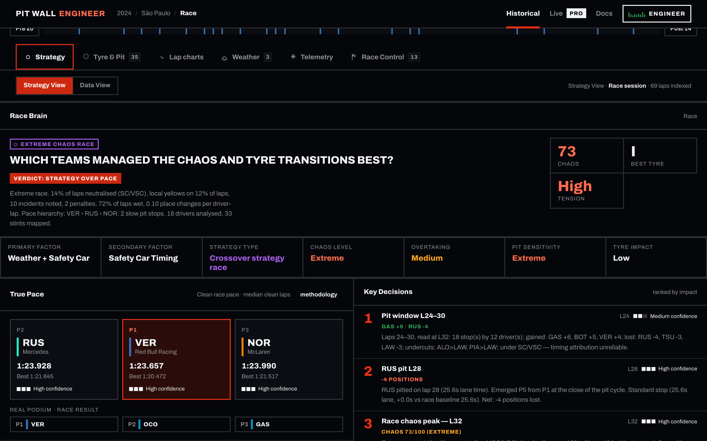
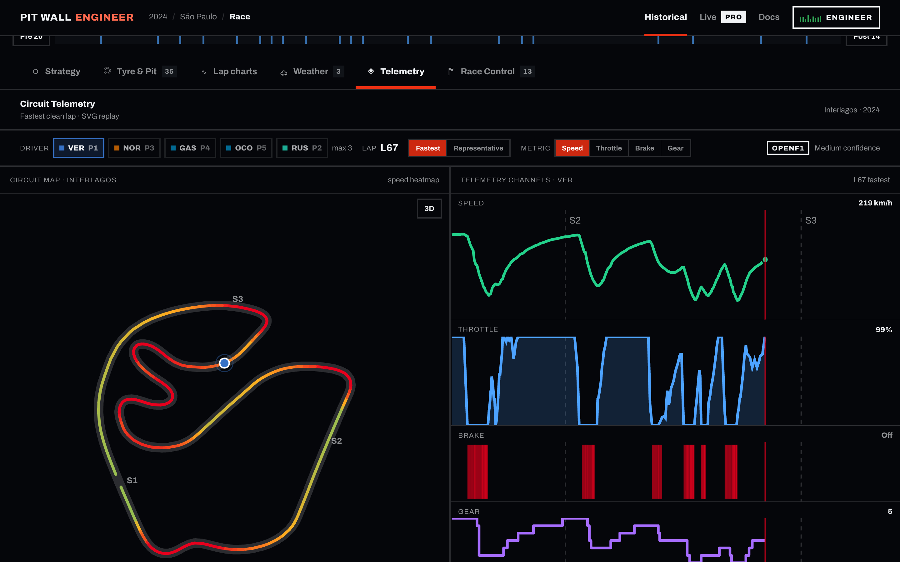
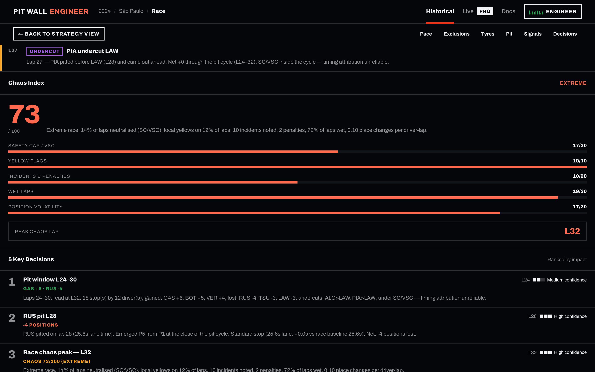

<div align="center">

# Pit Wall Engineer

### Mira la F1 como un ingeniero, no como un espectador.

**[pitwallengineer.com](https://pitwallengineer.com)** · **[Docs: gratis, PRO y modo live](https://pitwallengineer.com/docs)** · [Read in English](README.md)


</div>

---

## Qué es

Pit Wall Engineer convierte los datos de cronometraje en bruto de la Fórmula 1 en el análisis que haría un ingeniero de carrera: ritmo real, degradación de neumáticos, impacto de las paradas, fases de carrera, caos, cruces de clima y telemetría por vuelta.

Durante una sesión, el modo Live aplica la misma mirada al feed en cuanto llega: tiempos, mapa de pista, datos del coche, neumáticos, estrategia, dirección de carrera y radio de equipos.

Cada cifra lleva su confianza y el tamaño de la muestra que la respalda. Una lectura que todavía no se puede juzgar se etiqueta como tal, nunca se redondea hasta convertirla en certeza.

<p align="center">
  
</p>

---

## Principio de producto: confianza y tamaño de muestra

Un ranking construido con cuatro vueltas no es un ranking construido con cuarenta. El producto lo trata como una regla de diseño, no como una nota al pie.

- Los resultados de ritmo muestran en cuántas vueltas limpias se apoyan y llevan un nivel de confianza derivado de ese número.
- Las vueltas excluidas se registran con su motivo, de modo que cualquier ranking se puede auditar.
- Los cruces de clima que coinciden con un safety car se marcan y se rebajan, no se atribuyen solo a la elección de neumático.
- En modo Live, el Chaos Index se muestra como densidad sobre las vueltas disputadas hasta el momento, con su advertencia; el índice final solo existe tras la bandera a cuadros.
- Las señales de ventana de parada son mediciones con una confianza y una base declarada, nunca una vuelta de parada predicha.
- Un valor que los datos no sostienen se oculta y la página explica por qué, en lugar de mostrarse mal: la g lateral de las vueltas FastF1 se retiene hasta que se corrija su cálculo.

---

## Módulos y la pregunta que responde cada uno

| Módulo | Pregunta estratégica |
|---|---|
| **True Pace** | ¿Quién fue realmente rápido una vez quitadas las vueltas de boxes, de safety car y las atípicas? |
| **Degradación de neumáticos** | ¿Dónde empezó a caer cada stint y con qué pendiente? |
| **Impacto de paradas** | ¿La parada ganó o perdió posiciones, y el undercut fue real? |
| **Fases de carrera** | ¿Qué hacía la carrera en cada vuelta: ordenarse, ventana de paradas, reinicio tras safety car, empuje final? |
| **Chaos Index** | ¿Cuán desordenada fue la carrera y en qué vuelta alcanzó su pico? |
| **DRS trains** | ¿Cuándo quedaron coches atrapados en grupo y durante cuánto tiempo? |
| **Cruces de clima** | ¿Quién se adelantó, acertó o llegó tarde cuando cambió la pista? |
| **Valor del aire limpio** | ¿Cuánto valía rodar libre frente a rodar en tráfico? |
| **Lap charts** | ¿Cómo evolucionaron los tiempos y las distancias, vuelta a vuelta? |
| **Telemetría por vuelta** | ¿En qué se diferenciaron los pilotos en velocidad, acelerador, freno, marcha y g en una vuelta? |
| **Dirección de carrera y radio** | ¿Qué dijeron los comisarios y el muro de boxes, y cuándo? |
| **Recon Lap** | ¿Qué le pide este circuito a un coche: dónde están las zonas de frenada, cuánta velocidad se pierde, en qué marcha y con cuánto desnivel? |
| **Ingeniero de carrera IA** | ¿Qué dice esta carrera concreta sobre una pregunta que tengo? |

### Modo Live

Una vista de sesión con ocho pestañas: **Timing**, **Track & car**, **Strategy**, **Predictions** (solo cuando el servidor live envía una proyección), **Race control & radio**, **Lap charts**, **Engineer AI** y **Feed**.

- **Timing:** orden, distancias y sectores, récords de la sesión y meteorología.
- **Track & car:** un mapa de pista dibujado a partir de la primera vuelta limpia de la sesión, la posición de cada coche y la velocidad, marcha, RPM, acelerador, freno y estado del DRS del coche seleccionado.
- **Strategy:** ritmo limpio hasta el momento, la vigilancia de paradas (tandas largas en libres), tiempos en el pit lane, stints y compuestos de neumáticos, adelantamientos.
- **Race control & radio:** banderas, incidentes y mensajes de safety car, radio de equipos y las notas del ingeniero con la densidad de caos hasta el momento. Los clips de radio se enlazan desde el archivo oficial, nunca se copian ni se guardan aquí.

Los libres y la clasificación tienen su propio perfil: mejores vueltas, colores de sector, tandas largas y estado de la sesión.

<p align="center">
  
</p>

### Telemetría por vuelta

La pestaña de telemetría reproduce una vuelta por piloto, la más rápida limpia o la representativa, con velocidad, acelerador, freno, marcha y fuerzas g sobre el mapa del circuito.

- **Fuente:** datos del coche de OpenF1 situados sobre la traza de posición, un archivo por carrera y modo de vuelta con toda la parrilla y la distancia escalada a la longitud oficial de la vuelta. Los archivos se sirven como JSON gzip desde Cloudflare R2.
- **Respaldo:** una carrera que no está en R2 la sirve la API desde su caché FastF1, exactamente como antes. Una insignia en la pestaña indica la fuente, OpenF1 o FastF1.
- **g lateral:** se muestra en las vueltas OpenF1; en las vueltas FastF1 se retiene hasta que se corrija su cálculo, con el motivo en pantalla.

### Recon Lap

`/recon/<circuito>` presenta un circuito antes de su Gran Premio a partir de la vuelta de la pole de la temporada anterior: la línea que siguió el coche en 3D con su desnivel registrado, reproduciéndose sola y deteniéndose en cada zona de frenada, con velocidad, marcha, acelerador y freno, un minimapa con el avance de la vuelta y un perfil de altura.

- Las zonas de frenada se numeran BZ1, BZ2, etcétera, en el orden de la vuelta. No son los números de curva de la FIA, y la página lo dice.
- Las distancias se escalan a la longitud oficial de la vuelta, leída de la página de cada Gran Premio en formula1.com y guardada con su fuente en `data/circuit_lengths.json`, la misma tabla que usa la telemetría por vuelta.
- El generador no publica un circuito cuyo desnivel registrado no sea plausible (un circuito llano por encima de 15 m, cualquier circuito por encima de 120 m, o una segunda vuelta que no coincida) hasta que alguien lo haya revisado.
- La vista 3D solo se carga en esa página. Con movimiento reducido, ahorro de datos o un móvil lento, es una imagen fija y la tabla de zonas de frenada.
- El primer circuito es Interlagos, antes del Gran Premio de São Paulo.

---

## Capturas

Tomadas de una carrera histórica publicada con [`scripts/readme_shots.py`](scripts/readme_shots.py).

| | |
|---|---|
|  |  |
| Análisis de carrera | Modo Live |
|  |  |
| Telemetría por vuelta | Chaos Index y fases de carrera |

---

## Arquitectura

```
OpenF1 (REST + MQTT)
  |
  |-- API de análisis (FastAPI, Render)
  |     cliente OpenF1 asíncrono (httpx, semáforo, reintentos)
  |     caché JSON por sesión, inmutable para carreras pasadas
  |     RaceTimeline (un objeto canónico compartido por todos los servicios)
  |     servicios: pace, tyre, pit, chaos, drs, weather, crossover,
  |                race phase, clean air, decisions, notes, DNA
  |     telemetría FastF1 desde caché (respaldo de la pestaña de telemetría)
  |     chat IA: Ollama en local, Groq en producción
  |
  |-- Recorder (Render, disco persistente)
  |     mantiene la suscripción MQTT, escribe la captura,
  |     archiva las capturas terminadas en Cloudflare R2
  |
  |-- Servidor live (Render)
  |     segunda suscripción MQTT, un snapshot, SSE a los navegadores
  |
  |-- GitHub Actions
  |     publish-race: publica cada carrera terminada en backend/cache/
  |     telemetry-openf1: genera la telemetría por vuelta y la sube a R2
  |
Cloudflare R2
      archivo de capturas live; archivos de telemetría tras un dominio público
  |
Frontend (Next.js 14 en Netlify)
      análisis histórico, modo Live, Recon Lap, docs, ajustes de acceso
```

- **Frontend:** Next.js 14 (App Router), TypeScript strict, Tailwind, Framer Motion, Zustand, Recharts, y three.js solo en la página de la Recon Lap. Las fuentes se sirven desde el repo, así que un build no necesita red. Desplegado en Netlify.
- **Backend:** FastAPI, Pydantic v2, Polars, NumPy, httpx. Desplegado en Render.
- **Fuente:** OpenF1 para vueltas, stints, paradas, posiciones, intervalos, dirección de carrera, meteorología, pilotos, datos del coche, posición en pista y el feed MQTT en directo. FastF1 para el respaldo de telemetría.
- **Cloudflare R2:** almacenamiento compatible con S3 para dos cosas: el archivo de capturas live terminadas del recorder y los archivos de telemetría por vuelta que la pestaña de telemetría lee primero.
- **Por qué el recorder y el servidor live están separados:** un fallo en el visor nunca debe detener la grabación, y el MQTT de OpenF1 no tiene repetición. Ver [docs/live-infrastructure.md](docs/live-infrastructure.md) y [docs/live-deployment.md](docs/live-deployment.md).
- **Publicación:** `publish-race` hace commit de cada carrera terminada en `backend/cache/` y después pone en cola `telemetry-openf1` para ella, que escribe en R2 sin commit ni despliegue. Un commit en `main` es un despliegue, por eso el blueprint de Render usa filtros de build. Ver [docs/DEPLOY.md](docs/DEPLOY.md) y [docs/telemetry-openf1.md](docs/telemetry-openf1.md).

---

## Planes y acceso

| | Temporadas | Incluye |
|---|---|---|
| **Gratis** | 2023 y 2024 | Análisis completo, todos los tipos de sesión, sin cuenta |
| **PRO** | 2025 en adelante y la temporada actual | Lo anterior más el modo Live, 2,99 EUR al mes |

- **Códigos de acceso:** PRO está disponible con un código de acceso, introducido una vez en Ajustes. La puerta vive en el backend; el navegador solo guarda un token firmado.
- **Suscripciones:** las suscripciones PRO mensuales están integradas y permanecen apagadas tras un flag hasta que se abran. Apagadas, ningún código de pago llega al navegador y el sitio dice que las suscripciones abren pronto.
- **Códigos promocionales:** un código público definido en `PRO_PROMO_CODES` (código e instante de fin) lo puede canjear cualquiera, sin distinguir mayúsculas, hasta que termina. Un banner muestra el código con una cuenta atrás y un campo para canjearlo. Un código canjeado da PRO durante `PRO_PROMO_TOKEN_TTL_DAYS` días y sigue funcionando cuando el código ya ha terminado. El código vive en el entorno de la API, nunca en este repo.
- **Semana abierta:** definir `OPEN_ACCESS_UNTIL` en la API y en el servidor live abre todas las temporadas PRO y el modo Live a todo el mundo hasta ese instante. Pasado ese momento, todo vuelve a ser como antes sin desplegar.

Detalles en [pitwallengineer.com/docs](https://pitwallengineer.com/docs).

---

## Ejecutarlo en local

Requisitos: Python 3.11, Node.js 18 o superior. Ollama con `llama3.1:8b` es opcional y solo lo usa el chat IA.

```bash
# Backend
cd backend
python -m venv .venv
source .venv/bin/activate        # Windows: .venv\Scripts\activate
pip install -r requirements.txt
cp .env.example .env
uvicorn app.main:app --reload    # http://localhost:8000
```

```bash
# Frontend
cd frontend
cp .env.local.example .env.local
npm install
npm run dev                      # http://localhost:3000
```

Tests:

```bash
cd backend && pip install -r requirements-dev.txt && pytest
cd frontend && npm test
```

### Modo Live sobre una grabación

```bash
cd backend
pip install -r requirements-live.txt
python scripts/live_server.py --replay 9636 --replay-speed 0.02
# o reproducir una captura grabada por el recorder:
python scripts/live_server.py --replay-capture <carpeta de la captura> --speed 60

cd ../frontend
NEXT_PUBLIC_LIVE_URL=http://localhost:8099 npm run dev
```

### Telemetría por vuelta de una carrera

```bash
cd backend
python scripts/openf1_telemetry.py --sessions <session_key> --out telemetry-out
# caché de respaldo FastF1, como antes:
python scripts/precompute_telemetry.py --sessions <session_key> --drivers VER,NOR,LEC,PIA,RUS
```

Apunta `NEXT_PUBLIC_TELEMETRY_URL` a un servidor de `telemetry-out` para leer los archivos en local; déjala vacía para usar la API.

### Una Recon Lap

```bash
cd frontend
python3 scripts/recon/build_recon.py Interlagos --for-year 2026   # escribe public/recon/interlagos.json
```

Ambos generadores leen OpenF1 con `OPENF1_USERNAME` y `OPENF1_PASSWORD` si están definidas, y de forma anónima si no.

---

## Variables de entorno

Solo nombres. Los valores reales van en los paneles de cada servicio, nunca en el repo. Plantillas: `backend/.env.example` y `frontend/.env.local.example`.

**API de análisis**

| Variable | Para qué |
|---|---|
| `OPENF1_BASE_URL` | URL base REST de OpenF1 |
| `OPENF1_USERNAME`, `OPENF1_PASSWORD` | Cuenta de OpenF1, que se canjea por un token renovable |
| `OPENF1_API_TOKEN` | Token estático antiguo, ignorado si hay usuario y contraseña |
| `CACHE_DIR` | Dónde se guarda el JSON de cada sesión |
| `CORS_ORIGINS` | Orígenes de navegador permitidos |
| `ENVIRONMENT` | `development` o `production` |
| `OLLAMA_BASE_URL`, `OLLAMA_MODEL` | Chat IA en local |
| `GROQ_API_KEY`, `GROQ_MODEL`, `GROQ_REASONING_EFFORT` | Chat IA en producción |
| `FREE_SEASONS` | Temporadas abiertas a todos |
| `PRO_ACCESS_CODES`, `PRO_TOKEN_SECRET`, `PRO_TOKEN_TTL_DAYS` | Puerta PRO |
| `PRO_PROMO_CODES`, `PRO_PROMO_TOKEN_TTL_DAYS` | Códigos promocionales públicos como `CÓDIGO\|instante ISO 8601 con su zona`, y cuánto dura uno canjeado |
| `OPEN_ACCESS_UNTIL` | Semana abierta: un instante ISO 8601 con su zona horaria |
| `INTERNAL_BUILD_SECRET` | Permite a la Action de publicación calcular temporadas PRO |
| `PAYMENTS_ENABLED` | Suscripciones encendidas o apagadas |
| `STRIPE_SECRET_KEY`, `STRIPE_PRICE_ID`, `STRIPE_WEBHOOK_SECRET` | Stripe Checkout y webhooks |
| `PAYMENTS_RETURN_URL`, `PAYMENTS_REVOKED_SUBS` | Dirección de retorno y suscripciones revocadas |
| `RESEND_API_KEY`, `RESEND_FROM` | Correos de recuperación de acceso |
| `TELEGRAM_BOT_TOKEN`, `TELEGRAM_PRO_CHAT_ID`, `TELEGRAM_WEBHOOK_SECRET` | Canal PRO |

**Recorder y servidor live**

| Variable | Para qué |
|---|---|
| `CAPTURE_BUCKET`, `CAPTURE_ENDPOINT_URL`, `CAPTURE_REGION` | Archivo compatible con S3 (Cloudflare R2) |
| `AWS_ACCESS_KEY_ID`, `AWS_SECRET_ACCESS_KEY` | Credenciales de ese bucket |
| `LIVE_ALLOWED_ORIGINS` | Orígenes que pueden abrir el stream live |
| `PRO_ACCESS_CODES`, `PRO_PROMO_CODES`, `PRO_TOKEN_SECRET` | Los mismos valores que en la API, para que sus tokens abran el modo Live |
| `OPEN_ACCESS_UNTIL` | Semana abierta, como en la API |
| `TELEGRAM_BOT_TOKEN`, `TELEGRAM_CHAT_ID` | Notificaciones operativas |

**Frontend (se leen en el build)**

| Variable | Para qué |
|---|---|
| `NEXT_PUBLIC_API_URL` | API de análisis |
| `NEXT_PUBLIC_LIVE_URL` | Servidor live |
| `NEXT_PUBLIC_TELEMETRY_URL` | Base pública de los archivos de telemetría en R2; vacía significa solo la API |
| `NEXT_PUBLIC_PAYMENTS_ENABLED` | Mostrar o no las suscripciones |
| `NEXT_PUBLIC_PW_BUILD` | Etiqueta del build |

**GitHub Actions**

| Nombre | Para qué |
|---|---|
| `OPENF1_USERNAME`, `OPENF1_PASSWORD` | Publicación y telemetría por vuelta |
| `INTERNAL_BUILD_SECRET` | Publicación de temporadas PRO |
| `R2_ACCOUNT_ID`, `R2_ACCESS_KEY_ID`, `R2_SECRET_ACCESS_KEY` | Subida de la telemetría (un token limitado a un bucket) |
| `R2_BUCKET` | Variable del repositorio, el bucket de telemetría |
| `TELEGRAM_BOT_TOKEN`, `TELEGRAM_CHAT_ID` | Informes de publicación |

---

## Datos y atribución

Los datos de sesión, del coche y de posición vienen de [OpenF1](https://openf1.org); el respaldo de telemetría, de FastF1. Los datos históricos empiezan en 2023. Las longitudes oficiales de vuelta vienen de la página de cada Gran Premio en formula1.com, con la fuente guardada en cada fila. Los clips de radio de equipos se enlazan desde el archivo oficial y nunca se copian ni se guardan aquí.

## Licencia

MIT, ver [LICENSE](LICENSE). Las fuentes tipográficas están bajo la SIL Open Font License, con sus licencias al lado.

**Proyecto no oficial. Sin relación con la Fórmula 1, la FIA ni ningún equipo.** F1, FORMULA 1 y las marcas relacionadas son marcas registradas de Formula One Licensing B.V.
