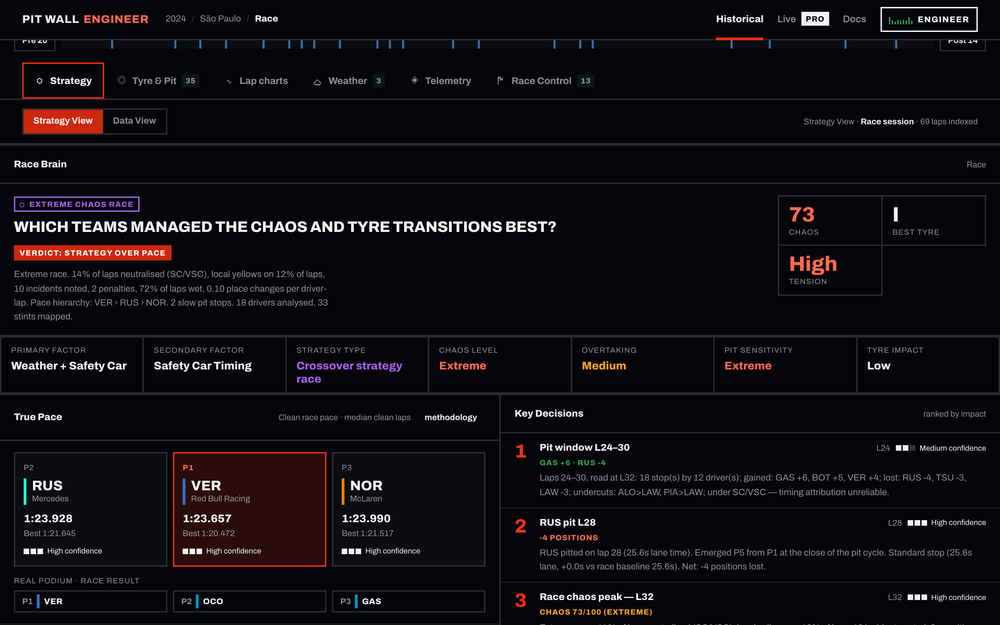
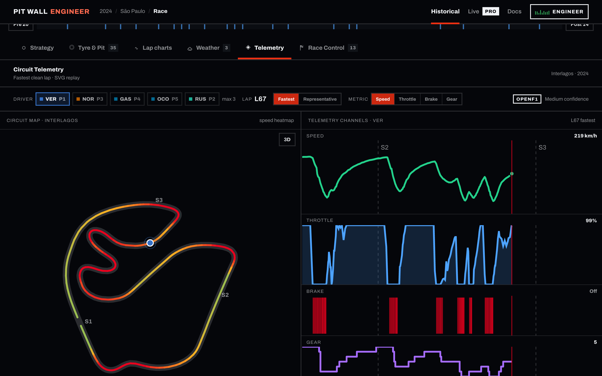
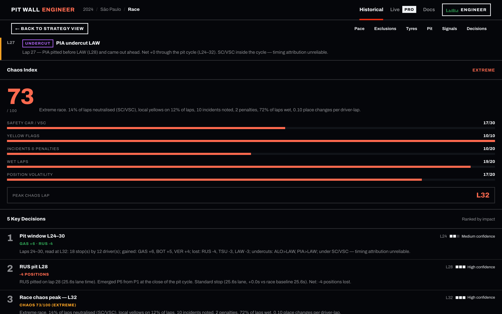

<div align="center">

# Pit Wall Engineer

### Watch F1 like an engineer, not like a spectator.

**[pitwallengineer.com](https://pitwallengineer.com)** · **[Docs: free, PRO and live mode](https://pitwallengineer.com/docs)** · [Leer en español](README.es.md)


</div>

---

## What it is

Pit Wall Engineer turns raw Formula 1 timing data into the analysis a race engineer would run: true pace, tyre degradation, pit impact, race phases, chaos, weather crossovers and lap telemetry.

During a session, Live mode puts the same lens on the feed as it arrives: timing, track map, car data, tyres, strategy, race control and team radio.

Every number carries its confidence and the size of the sample behind it. A reading that cannot be judged yet is labelled as such, never rounded into certainty.

<p align="center">
  
</p>

---

## Product principle: confidence and sample size

A ranking built on four laps is not a ranking built on forty. The product treats that as a design rule, not a footnote.

- Pace results show how many clean laps they rest on and carry a confidence level derived from that count.
- Excluded laps are logged with the reason, so every ranking can be audited.
- Weather crossovers that overlap a safety car are flagged and downgraded, not credited to tyre choice alone.
- In Live mode, the Chaos Index is shown as a density over the laps run so far, with its caveat; the final index only exists after the chequered flag.
- Pit window signals are measurements with a confidence and a stated basis, never a predicted stop lap.
- A value the data cannot support is hidden and the page says why, rather than shown wrong: lateral g from FastF1 laps is withheld until its calculation is fixed.

---

## Modules and the question each one answers

| Module | Strategic question |
|---|---|
| **True Pace** | Who was actually fast once pit laps, safety car laps and outliers are removed? |
| **Tyre degradation** | Where did each stint start to fall off, and how steep was it? |
| **Pit impact** | Did the stop gain or lose positions, and was the undercut real? |
| **Race phases** | What was the race doing on each lap: sorting, pit window, safety car reset, final push? |
| **Chaos Index** | How disordered was the race, and on which lap did it peak? |
| **DRS trains** | When were cars stuck in a group, and for how long? |
| **Weather crossovers** | Who was early, on time or late when the track changed? |
| **Clean air value** | What was running free worth against running in traffic? |
| **Lap charts** | How did lap times and gaps evolve, lap by lap? |
| **Telemetry replay** | How did the drivers differ through speed, throttle, brake, gear and g on one lap? |
| **Race control and radio** | What did the stewards and the pit wall say, and when? |
| **Recon Lap** | What does this circuit ask of a car: where are the braking zones, how much speed is lost, in which gear, over how much height? |
| **AI race engineer** | What does this specific race say about a question I have? |

### Live mode

A session view with eight tabs: **Timing**, **Track & car**, **Strategy**, **Predictions** (only when the live server sends a projection), **Race control & radio**, **Lap charts**, **Engineer AI** and **Feed**.

- **Timing:** order, gaps and sectors, session records and weather.
- **Track & car:** a track map drawn from the session's first clean lap, every car's position, and the selected car's speed, gear, RPM, throttle, brake and DRS state.
- **Strategy:** clean pace so far, the pit watch (long runs in practice), pit lane times, tyre stints and compounds, overtakes.
- **Race control & radio:** flags, incidents and safety car messages, team radio, and the engineer's notes with the chaos density so far. Radio clips are linked from the official archive, never copied or stored here.

Practice and qualifying sessions get their own profile: best laps, sector colours, long runs and session status.

### Lap telemetry

The telemetry tab replays one lap per driver, fastest clean or representative, with speed, throttle, brake, gear and g forces against the circuit map.

- **Source:** OpenF1 car data placed on the location trace, one file per race and lap mode with the whole field, distance scaled to the official lap length. The files are served as gzip JSON from Cloudflare R2.
- **Fallback:** a race that is not on R2 is served by the API from its FastF1 cache, exactly as before. A badge in the tab names the source, OpenF1 or FastF1.
- **Lateral g:** shown for OpenF1 laps; withheld on FastF1 laps until their calculation is fixed, with the reason on screen.

### Recon Lap

`/recon/<circuit>` previews a circuit before its Grand Prix from the previous season's pole lap: the line the car took in 3D with its recorded height, playing by itself and holding at every braking zone, with speed, gear, throttle and brake, a minimap with the lap's progress and a height profile.

- Braking zones are numbered BZ1, BZ2 and so on in lap order. They are not the FIA turn numbers, and the page says so.
- Distances are scaled to the official lap length, read from each Grand Prix's page on formula1.com and kept with its source in `data/circuit_lengths.json`, the same table the lap telemetry uses.
- The generator refuses to publish a circuit whose recorded height is implausible (a flat circuit over 15 m, any circuit over 120 m, or a second lap that disagrees) until someone has reviewed it.
- The 3D view loads only on that page. With reduced motion, data saver or a slow phone, it is a still image and the braking zone table.
- The first circuit is Interlagos, ahead of the São Paulo Grand Prix.

---

## Screenshots

Captured from a published historical race by [`scripts/readme_shots.py`](scripts/readme_shots.py).

| | | |
|---|---|---|
|  |  |  |
| Race analysis | Lap telemetry | Chaos Index and key decisions |

São Paulo 2024 race, captured from the live site. A Live mode capture follows during a race weekend.

---

## Architecture

```
OpenF1 (REST + MQTT)
  |
  |-- Analysis API (FastAPI, Render)
  |     async OpenF1 client (httpx, semaphore, retry)
  |     per-session JSON cache, immutable for past races
  |     RaceTimeline (one canonical object shared by every service)
  |     services: pace, tyre, pit, chaos, drs, weather, crossover,
  |               race phase, clean air, decisions, notes, DNA
  |     FastF1 telemetry from cache (fallback for the telemetry tab)
  |     AI chat: Ollama locally, Groq in production
  |
  |-- Recorder (Render, persistent disk)
  |     holds the MQTT subscription, writes the capture,
  |     archives finished captures to Cloudflare R2
  |
  |-- Live server (Render)
  |     second MQTT subscription, one snapshot, SSE to browsers
  |
  |-- GitHub Actions
  |     publish-race: publishes each finished race into backend/cache/
  |     telemetry-openf1: builds the race's lap telemetry and uploads it to R2
  |
Cloudflare R2
      live capture archive; lap telemetry files behind a public domain
  |
Frontend (Next.js 14 on Netlify)
      historical analysis, Live mode, Recon Lap, docs, access settings
```

- **Frontend:** Next.js 14 (App Router), TypeScript strict, Tailwind, Framer Motion, Zustand, Recharts, and three.js on the Recon Lap page only. Fonts are served from the repo, so a build needs no network. Deployed on Netlify.
- **Backend:** FastAPI, Pydantic v2, Polars, NumPy, httpx. Deployed on Render.
- **Source:** OpenF1 for laps, stints, pit stops, position, intervals, race control, weather, drivers, car data, location and the live MQTT feed. FastF1 for the telemetry fallback.
- **Cloudflare R2:** S3-compatible storage for two things: the recorder's archive of finished live captures, and the lap telemetry files the telemetry tab reads first.
- **Why the recorder and the live server are separate:** a bug in the viewer must never stop the recording, and OpenF1 MQTT has no replay. See [docs/live-infrastructure.md](docs/live-infrastructure.md) and [docs/live-deployment.md](docs/live-deployment.md).
- **Publication:** `publish-race` commits each finished race into `backend/cache/` and then queues `telemetry-openf1` for it, which writes to R2 without a commit or a deploy. A commit to `main` is a deploy, which is why the Render blueprint uses build filters. See [docs/DEPLOY.md](docs/DEPLOY.md) and [docs/telemetry-openf1.md](docs/telemetry-openf1.md).

---

## Plans and access

| | Seasons | Includes |
|---|---|---|
| **Free** | 2023 and 2024 | Full analysis, every session type, no account |
| **PRO** | 2025 onwards and the current season | The above plus Live mode, EUR 2.99 per month |

- **Access codes:** PRO is available with an access code, entered once in Settings. The gate lives on the backend; the browser only holds a signed token.
- **Subscriptions:** monthly PRO subscriptions are built in and stay off behind a flag until they open. Off, no payment code reaches the browser and the site says subscriptions open soon.
- **Promo codes:** a public code set in `PRO_PROMO_CODES` (code and end instant) can be redeemed by anyone, in any case, until it ends. A banner shows the code with a countdown and a field to redeem it. A redeemed code gives PRO for `PRO_PROMO_TOKEN_TTL_DAYS` days, and keeps working after the code itself ends. The code lives in the API's environment, never in this repo.
- **Open week:** setting `OPEN_ACCESS_UNTIL` on the API and the live server opens every PRO season and Live mode to everyone until that instant. Past it, everything is as before without a deploy.

Details at [pitwallengineer.com/docs](https://pitwallengineer.com/docs).

---

## Run it locally

Requirements: Python 3.11, Node.js 18 or later. Ollama with `llama3.1:8b` is optional and only used by the AI chat.

```bash
# Backend
cd backend
python -m venv .venv
source .venv/bin/activate        # Windows: .venv\Scripts\activate
pip install -r requirements.txt
cp .env.example .env
uvicorn app.main:app --reload    # http://localhost:8000
```

```bash
# Frontend
cd frontend
cp .env.local.example .env.local
npm install
npm run dev                      # http://localhost:3000
```

Tests:

```bash
cd backend && pip install -r requirements-dev.txt && pytest
cd frontend && npm test
```

### Live mode against a recording

```bash
cd backend
pip install -r requirements-live.txt
python scripts/live_server.py --replay 9636 --replay-speed 0.02
# or replay a capture recorded by the recorder:
python scripts/live_server.py --replay-capture <capture dir> --speed 60

cd ../frontend
NEXT_PUBLIC_LIVE_URL=http://localhost:8099 npm run dev
```

### Lap telemetry for a race

```bash
cd backend
python scripts/openf1_telemetry.py --sessions <session_key> --out telemetry-out
# FastF1 fallback cache, as before:
python scripts/precompute_telemetry.py --sessions <session_key> --drivers VER,NOR,LEC,PIA,RUS
```

Point `NEXT_PUBLIC_TELEMETRY_URL` at a server for `telemetry-out` to read the files locally; leave it empty to use the API.

### A Recon Lap

```bash
cd frontend
python3 scripts/recon/build_recon.py Interlagos --for-year 2026   # writes public/recon/interlagos.json
```

Both generators read OpenF1 with `OPENF1_USERNAME` and `OPENF1_PASSWORD` when set, anonymously otherwise.

---

## Environment variables

Names only. Real values belong in the host dashboards, never in the repo. Templates: `backend/.env.example` and `frontend/.env.local.example`.

**Analysis API**

| Variable | Purpose |
|---|---|
| `OPENF1_BASE_URL` | OpenF1 REST base URL |
| `OPENF1_USERNAME`, `OPENF1_PASSWORD` | OpenF1 account, exchanged for a renewing bearer token |
| `OPENF1_API_TOKEN` | Legacy static token, ignored when username and password are set |
| `CACHE_DIR` | Where per-session JSON is stored |
| `CORS_ORIGINS` | Allowed browser origins |
| `ENVIRONMENT` | `development` or `production` |
| `OLLAMA_BASE_URL`, `OLLAMA_MODEL` | Local AI chat |
| `GROQ_API_KEY`, `GROQ_MODEL`, `GROQ_REASONING_EFFORT` | Production AI chat |
| `FREE_SEASONS` | Seasons open to everyone |
| `PRO_ACCESS_CODES`, `PRO_TOKEN_SECRET`, `PRO_TOKEN_TTL_DAYS` | PRO gate |
| `PRO_PROMO_CODES`, `PRO_PROMO_TOKEN_TTL_DAYS` | Public promo codes as `CODE\|ISO 8601 instant with its zone`, and how long a redeemed one lasts |
| `OPEN_ACCESS_UNTIL` | Open week: an ISO 8601 instant with its time zone |
| `INTERNAL_BUILD_SECRET` | Lets the publication Action compute PRO seasons |
| `PAYMENTS_ENABLED` | Subscriptions on or off |
| `STRIPE_SECRET_KEY`, `STRIPE_PRICE_ID`, `STRIPE_WEBHOOK_SECRET` | Stripe Checkout and webhooks |
| `PAYMENTS_RETURN_URL`, `PAYMENTS_REVOKED_SUBS` | Return address and revoked subscriptions |
| `RESEND_API_KEY`, `RESEND_FROM` | Restore access emails |
| `TELEGRAM_BOT_TOKEN`, `TELEGRAM_PRO_CHAT_ID`, `TELEGRAM_WEBHOOK_SECRET` | PRO channel |

**Recorder and live server**

| Variable | Purpose |
|---|---|
| `CAPTURE_BUCKET`, `CAPTURE_ENDPOINT_URL`, `CAPTURE_REGION` | S3-compatible archive (Cloudflare R2) |
| `AWS_ACCESS_KEY_ID`, `AWS_SECRET_ACCESS_KEY` | Credentials for that bucket |
| `LIVE_ALLOWED_ORIGINS` | Origins allowed to open the live stream |
| `PRO_ACCESS_CODES`, `PRO_PROMO_CODES`, `PRO_TOKEN_SECRET` | The same values as the API, so its tokens open Live mode |
| `OPEN_ACCESS_UNTIL` | Open week, as on the API |
| `TELEGRAM_BOT_TOKEN`, `TELEGRAM_CHAT_ID` | Operational notifications |

**Frontend (read at build time)**

| Variable | Purpose |
|---|---|
| `NEXT_PUBLIC_API_URL` | Analysis API |
| `NEXT_PUBLIC_LIVE_URL` | Live server |
| `NEXT_PUBLIC_TELEMETRY_URL` | Public base of the lap telemetry files on R2; empty means the API only |
| `NEXT_PUBLIC_PAYMENTS_ENABLED` | Subscriptions shown or not |
| `NEXT_PUBLIC_PW_BUILD` | Build label |

**GitHub Actions**

| Name | Purpose |
|---|---|
| `OPENF1_USERNAME`, `OPENF1_PASSWORD` | Publication and lap telemetry |
| `INTERNAL_BUILD_SECRET` | Publication of PRO seasons |
| `R2_ACCOUNT_ID`, `R2_ACCESS_KEY_ID`, `R2_SECRET_ACCESS_KEY` | Upload of lap telemetry (a token scoped to one bucket) |
| `R2_BUCKET` | Repository variable, the telemetry bucket |
| `TELEGRAM_BOT_TOKEN`, `TELEGRAM_CHAT_ID` | Publication reports |

---

## Data and attribution

Session data, car data and location come from [OpenF1](https://openf1.org); the telemetry fallback from FastF1. Historical data starts in 2023. Official lap lengths come from each Grand Prix's page on formula1.com, with the source kept per row. Team radio clips are linked from the official archive and are never copied or stored here.

## License

MIT, see [LICENSE](LICENSE). Fonts are under the SIL Open Font License, with their licences beside them.

**Unofficial project. Not affiliated with Formula 1, the FIA or any team.** F1, FORMULA 1 and related marks are trademarks of Formula One Licensing B.V.
